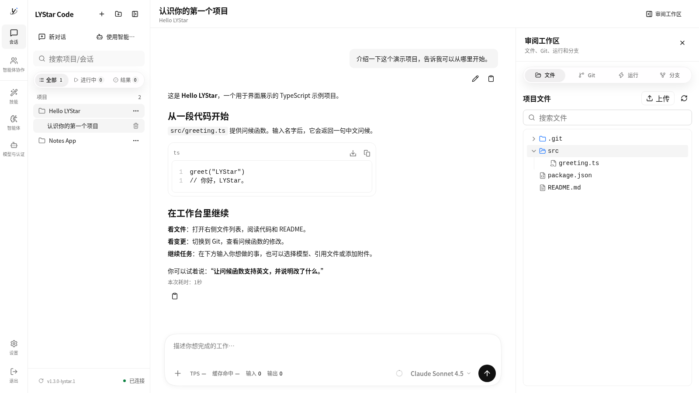
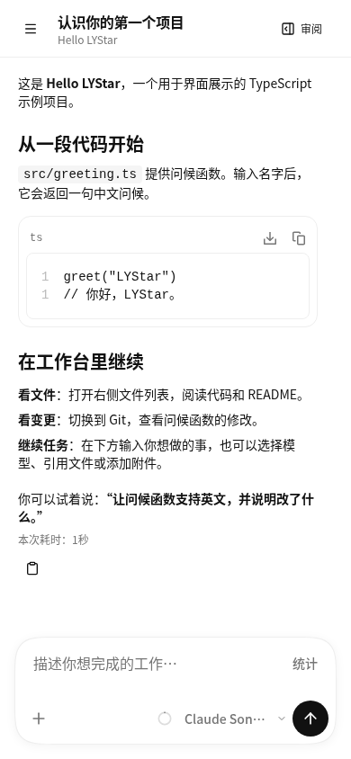

# LYStar Code

<p align="center"><strong>在浏览器里对话、写代码、看变更。</strong></p>

<p align="center">中文 AI 编码工作台，提供 WebUI 图形界面和全屏终端。<br>支持 macOS、Linux、Windows x64，安装独立发行包无需 Node.js。</p>

<p align="center">
  <a href="#安装">安装</a> ·
  <a href="#用-webui-开始">打开 WebUI</a> ·
  <a href="#常用命令">常用命令</a> ·
  <a href="docs/README.md">中文文档</a>
</p>

<p align="center">
  <picture>
    <source media="(prefers-color-scheme: dark)" srcset="docs/assets/lystar-web-dark.png">
    
  </picture>
</p>

<p align="center"><sub>WebUI 实际界面；截图使用独立演示项目，文件与对话均为示例。</sub></p>

把任务交给 Agent，在同一个页面里跟进执行、阅读文件、检查改动。你可以从一段代码开始，也可以配置不同职责的智能体，通过协作空间和任务看板一起处理项目。

## 你可以用它做什么

| 你想做的事 | 工作台提供的能力 |
| --- | --- |
| 读懂项目、修 Bug、实现功能 | Agent 读取和编辑文件、搜索代码、执行 Shell 命令，并在对话中呈现过程与结果 |
| 一边提需求，一边检查改动 | 右侧审阅工作区提供文件浏览、Git 变更与历史、运行记录和会话分支 |
| 同时处理多个项目 | 按项目管理会话，支持项目分组、搜索和历史会话继续 |
| 让多个智能体分工 | 配置智能体的模型、Skill 和工具，通过协作空间、成员消息和任务看板组织工作 |
| 使用自己的模型服务 | 配置 Provider、API Key 和自定义模型，在输入区切换模型与思考强度 |
| 从另一台设备查看和继续 | 服务运行在安装 LYStar 的电脑上，电脑或手机浏览器连接 WebUI |
| 沿用 Pi 生态 | 使用兼容的 Skill、Extension、Package、Theme、Prompt Template 和 MCP 工具 |

## 安装

### macOS / Linux

```bash
curl -fsSL https://github.com/lystar-team/lystar-code/releases/latest/download/install.sh | bash
```

安装器识别系统和架构，校验 SHA-256，并安装到 `~/.local/share/lystar-agent/`。macOS 与 Linux 均提供 x64、ARM64 发行包。

### Windows 10 / 11

在 Windows PowerShell 5.1 或更高版本中执行：

```powershell
$cmd="$env:TEMP\lystar-install.cmd"; iwr -UseBasicParsing https://github.com/lystar-team/lystar-code/releases/latest/download/install.cmd -OutFile $cmd; & $cmd
```

安装器提供中文向导，准备 WebView2 和托管 MinGit Bash，并配置用户 PATH。完成后新开终端，即可使用 `lc` 或 `lystar`，两个命令完全等价。

[手动安装与系统要求](docs/getting-started/installation.md) · [中国大陆网络配置](docs/getting-started/mainland-china.md)

## 用 WebUI 开始

安装后，在终端执行：

```bash
lc web
```

1. 按提示设置 Web 端口、Runtime 端口和连接密码。默认 Web 端口为 `1420`，Runtime 端口为 `1422`。
2. 在本机浏览器打开 `http://127.0.0.1:1420`，输入刚才设置的连接密码。如果改过端口，以终端输出的访问地址为准。
3. 打开“模型与认证”，配置模型供应商的 API Key；使用订阅登录的用户可先在终端运行 `lc`，执行 `/login`。
4. 点击“添加项目”，选择运行 LYStar 的电脑上的项目目录，再新建对话、选择模型并输入任务。

例如：

```text
阅读这个项目，告诉我如何启动、主要代码在哪里。先不要修改文件。
```

`lc web` 默认在后台运行，后续可直接打开浏览器访问。macOS 首次安装 Web 服务时会引导完成系统授权，详见[安装说明](docs/getting-started/installation.md)。

### 手机也能连接

在手机浏览器打开 `http://<运行 LYStar 的电脑 IP>:1420`，输入连接密码即可进入。两台设备需要网络互通；项目文件和任务都在运行 LYStar 的电脑上处理。

<p align="center">
  
</p>

访问配置、后台服务、模型设置和完整命令见 [WebUI 使用指南](docs/usage/webui.md)。

## 常用命令

| 操作 | 命令 |
| --- | --- |
| 启动 WebUI | `lc web` |
| 在当前终端前台运行 WebUI | `lc web --foreground` |
| 查看 Web 启动参数 | `lc web --help` |
| 安装 Web 后台服务 | `lc web service install` |
| 查看 Web 服务状态 | `lc web service status` |
| 启动 / 停止 / 重启 Web 服务 | `lc web service start` / `lc web service stop` / `lc web service restart` |
| 修复 Web 服务配置与运行状态 | `lc web service reconcile` |
| 卸载 Web 后台服务 | `lc web service uninstall` |
| 查看 macOS 系统授权 / 重新授权 | `lc web permissions status` / `lc web permissions setup` |
| 启动终端界面 | `lc` |
| 在终端继续最近会话 / 选择历史会话 | `lc -c` / `lc -r` |
| 更新应用 / 回退上一版本 | `lc update` / `lc update --rollback` |
| 卸载应用（保留用户数据） | `lc uninstall` |

单独管理 Gateway、Runtime 和停止指定会话的命令见 [WebUI 使用指南](docs/usage/webui.md#分别管理-gateway-与-runtime)。卸载应用和数据保留规则见[更新、回退与卸载](docs/usage/update-rollback-uninstall.md)。

## 习惯终端，也可以继续用

```bash
cd /path/to/project
lc
```

首次进入后执行 `/login` 登录模型服务，使用 `/model` 选择模型，再输入任务。中文全屏 TUI 支持键盘、鼠标滚动、工具输出展开和历史会话管理。

[5 分钟快速开始](docs/getting-started/quick-start.md) · [终端界面与快捷键](docs/usage/interactive-tui.md)

## 文档

| 需要了解的内容 | 入口 |
| --- | --- |
| 从安装到第一条任务 | [安装](docs/getting-started/installation.md) · [快速开始](docs/getting-started/quick-start.md) |
| 浏览器与手机使用、访问配置、后台服务 | [WebUI 使用指南](docs/usage/webui.md) |
| 模型登录、API Key 和国内模型服务 | [Provider 与 API Key](docs/getting-started/providers.md) |
| 配置、会话和项目规则 | [配置](docs/usage/configuration.md) · [Session 与项目规则](docs/usage/sessions-and-project-instructions.md) |
| Skill、Extension、Package | [生态资源](docs/ecosystem/overview.md) |
| 下载、网络和启动问题 | [故障排查](docs/troubleshooting/installation.md) · [中国大陆网络配置](docs/getting-started/mainland-china.md) |
| 源码开发与 Web 架构 | [开发环境](docs/development/setup.md) · [Web 架构总览](docs/development/web-overview.md) |

全部文档见[文档首页](docs/README.md)。

## 兼容性与限制

LYStar Code 当前版本为 `1.3.0-lystar.22`，基于 Pi `v1.3.0`。继续读取 `~/.pi/agent/`、项目 `.pi/`、Pi Session 和生态资源，并保留 `PI_*` 环境变量。Pi 与 LYStar 可以共用数据，但不要同时写同一个 Session 文件。

macOS 发行包尚未完成 Developer ID/notarization，Windows 发行包尚未完成 Authenticode。安装器和 Release 提供 SHA-256 与 GitHub artifact attestation；系统仍可能显示 Gatekeeper 或 SmartScreen 提示。

## 开发与贡献

源码开发需要 Node.js 22.19.0+、npm、Bun 1.4.2 和 Bash。开发入口、检查命令、发行流程与上游同步见[开发文档](docs/development/setup.md)。

## 来源与许可证

LYStar Code 基于 [earendil-works/pi](https://github.com/earendil-works/pi)，按 [MIT License](LICENSE) 发行。第三方依赖说明见 [THIRD_PARTY_LICENSES.md](THIRD_PARTY_LICENSES.md)。Grok Build 仅作为全屏 TUI 交互参考，没有复制其源码或资产。
