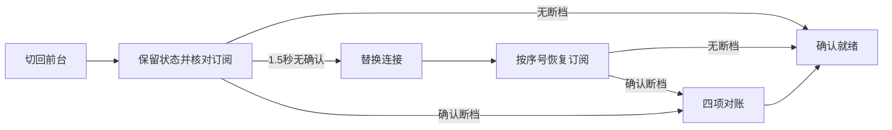

# 会话切屏恢复修复报告

核验日期：2026-10-19。修复已在源码工作区完成，并通过本地真实页面复测；未提交或发布。

## 根因

当前恢复入口把每次切回前台都当作会话失效：即使连接仍有效，也设置 `sessionReady=false` 和 `reconnecting=true`，同时刷新工作区、模型目录和项目订阅。真实页面记录到约 400 毫秒的主线程长任务，订阅确认因此延后。

另一个可复现断点是失效但仍显示 `OPEN` 的 WebSocket。旧代码只在原连接上重发订阅，不主动替换连接。只丢弃当前 socket 的订阅消息、保留其他请求并允许后续新连接正常通信时，旧代码重试 9 次，在 15,001 毫秒后报错，输入框持续禁用，未建立新连接。

正式日志中的历史问题也确实存在：旧版文件监听关闭曾阻塞主线程约 2.66–4.04 秒；当前正式版本的有限样本已降到 75–85 毫秒。本次没有改动文件监听实现。

用户报告的 5–6 秒是原使用环境的现象。本机正常连接基线约 0.5–0.6 秒，未在相同终端和网络上重现完整的 5–6 秒；本次确认并修复的是上述有源码和运行证据的恢复缺陷。

## 修复与重构

连接生命周期集中到 `packages/web/src/state/workbench-connection.ts`，由一个 Hook 管理建立、重试、前台核对、网络恢复、连接代次和定时器清理。`use-workbench.ts` 保留状态编排和前台状态提交。

- 正常切屏保留现有就绪状态，使用现有会话序号核对订阅；不再每次刷新工作区、模型目录或重新订阅项目。
- 前台核对 1.5 秒未收到确认，就关闭旧连接并建立新连接。旧连接事件通过连接代次与 socket 身份隔离。
- 同一轮核对未结束时合并重复恢复入口；断网、退出和卸载使用同一个连接清理入口。
- 建立连接有独立超时，避免永久停留在 `CONNECTING`。
- 服务端确认断档时，仍等待快照、操作、历史、子会话四项对账。
- 浏览器诊断记录前台恢复开始、确认、超时替换及下一动画帧中的就绪状态。替换连接后沿用同一轮起始时间。

## 对比与复测

环境：Linux 上的 Chromium，通过 agent-browser 操作本地开发页面，连接真实 Gateway / Runtime 与现有会话。正常切屏使用真实标签页切换，每次等待确认完成。失效连接与断档通过当前浏览器内的消息故障注入触发，没有修改服务端业务数据或发起模型请求。

| 场景 | 修复前证据 | 修复后结果 |
| --- | --- | --- |
| 正常切屏 | 两次订阅确认分别 488、594 毫秒；会话被设为未就绪 | 5 次订阅确认 24–100 毫秒；前台就绪帧 40.7–210.1 毫秒，中位数 80.9 毫秒；持续复用同一连接 |
| 旧连接吞掉订阅 | 15,001 毫秒超时，9 次重发，无新连接，输入框持续禁用 | 1,503 毫秒启动替换，2,292 毫秒收到确认，2,527 毫秒记录就绪；输入框自动恢复 |
| 服务端确认序号断档 | 原有四项对账机制 | 故意发送超出服务端范围的序号，服务端返回 `gap=true`；四项请求实际执行，626 毫秒记录就绪 |
| 正在执行工具的会话切屏 | 未另取修复前基线 | 本次正在运行的会话连续切屏 5 次，就绪帧分别 273.6、95.1、78.5、42.4、45.6 毫秒；保持任务状态 |
| 主动断开 WebSocket | 原有重连机制 | 自动新建连接并恢复可输入状态 |
| 浏览器离线后恢复网络 | 原有网络恢复机制 | 离线时输入禁用并显示状态未知，恢复网络后自动恢复可输入状态 |

“订阅确认”与“前台就绪帧”是两个口径；后者还包括状态提交及动画帧等待。以上是有限本地样本，不代表公网或移动设备的延迟上限。

## 验证结果

- 5 个已有相关测试文件全部通过，共 47 项：`connection-recovery`、`workbench-stream-recovery`、`workbench-session-race`、`session-sync`、`workbench-session-cache`。
- `npm run check` 通过，包含项目规定的静态、类型、依赖、协议及浏览器冒烟检查。
- `git diff --check` 通过；agent-browser 未报告页面 JavaScript 错误。
- 没有新增或删除测试文件、测试用例，也没有降低已有断言。

本地已证实正常切屏无需重新阻塞会话，失效旧连接能被主动替换，真实断档仍完成对账。正式安装版本尚未包含本次代码，原终端与公网环境的最终体验仍需在发布后核验。
