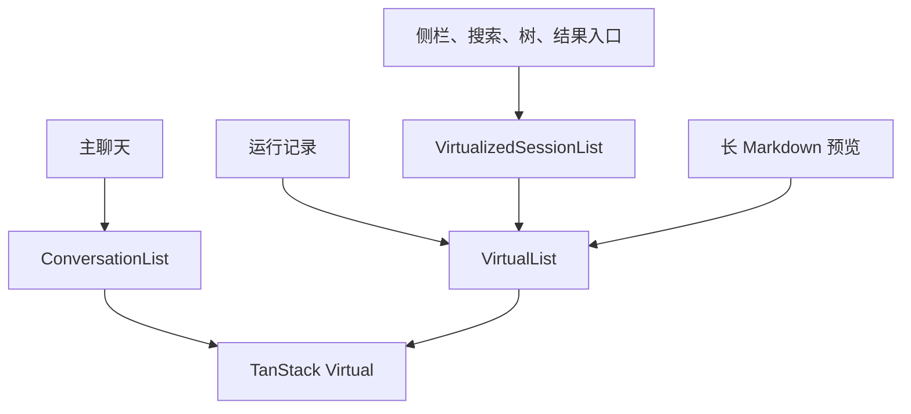

# Web 虚拟滚动统一迁移报告

Web 源码中的虚拟列表已统一使用 TanStack Virtual。主聊天、运行记录、会话列表和长 Markdown 预览均已接入；旧聊天虚拟列表、外层滚动补偿和手写会话窗口算法已删除。

## 组件与责任

直接依赖 `@tanstack/react-virtual` 固定为 `3.14.20`，锁文件中的 `@tanstack/virtual-core` 为 `3.19.5`。已移除 `react-virtuoso` 依赖及其锁文件记录。

| 业务入口 | 使用的组件 | 责任 |
| --- | --- | --- |
| 主聊天 | `workbench/conversation-list.tsx` | 测量可见行、历史插入锚定、流式跟随和位置恢复 |
| 运行记录 | `ui/virtual-list.tsx` | 测量运行记录行，沿用详情弹窗和外部滚动容器 |
| 项目侧栏、会话搜索、会话树、结果入口 | `workbench/virtualized-session-list.tsx` → `ui/virtual-list.tsx` | 沿用各入口的行高、间距和按 key 定位 |
| 长 Markdown 预览 | `ui/virtual-list.tsx` | 动态测量正文块，使用内部滚动容器 |

主聊天的分组树保持步骤、工具和工作过程的 DOM 层级；展开内容以稳定 key 形成独立测量行。跟随意图、历史请求、会话位置缓存、展开选择和收起动画分别维护。GSAP 负责折叠动画，实际滚动由 TanStack Virtual 执行。

公共列表保存外部滚动容器的现有位置，测量自身起点，并监听容器内容尺寸变化。定位请求在容器引用和起点就绪后执行，避免首次挂载时丢失跳转。多个列表共用滚动容器时，新增列表不会将容器重置到顶部。

## 已删除的实现

- `workbench/virtualized-transcript.tsx`：旧聊天及通用虚拟列表。
- `workbench/prepend-anchored-transcript.tsx`：外层历史插入和异步增高补偿。
- `VirtualizedSessionList` 中的手写窗口范围、占位和定位算法。
- 旧绝对索引、工具锚点哈希、`data-transcript-anchor-key` 标记及仅服务这些算法的常量。
- 两个旧实现专用测试文件。行为覆盖迁移至新列表模型、TanStack 锚定、跟随控制、历史请求和会话缓存测试。

## 测试调整

`conversation-scroll-trigger.test.ts` 分别验证列表控制和历史请求，覆盖暂停定位、恢复跟随、发送信号、会话切换、游标去重、失败重试及旧请求错误隔离。

迁移用例发现并修复了顶部向上意图残留：同一游标不能再次请求时也消费本次意图，下一页需要新的用户向上操作。

`conversation-review.test.ts` 使用新的可见行模型与 TanStack Virtual，验证工具组 key 改变、内部补页和上方尺寸变化后的偏移。新增 `conversation-list-model.test.ts` 验证组展开、收起动画保留行、Thinking 所属组展开和缓存代次。

Thinking 的旧固定底部槽断言已调整为当前事件顺序和可展开首行标题；本次没有改变 Thinking 的业务呈现。

## 验证

`npm run check` 通过，退出码为 0。14 个相关测试文件、161 项用例全部通过。执行范围包含聊天渲染、渲染管线、稳定性、步骤关联、历史请求、列表模型、会话列表、工具批次、工具呈现、消息、运行面板和转录状态。

浏览器通过 `test/fixtures/conversation-review.html` 与 `test/fixtures/virtual-list-review.html` 挂载真实组件，得到以下结果：

| 场景 | 结果 |
| --- | --- |
| 展开步骤内部补历史、上方正文增高 | 阅读位置误差 0px |
| 展开工具组从 50 条补到 60 条 | 阅读位置误差 0px；38 帧采样最大误差 0px |
| 连续输出、返回最新、切换会话恢复 | 跟随时距底部 0px；上翻阅读与恢复位置误差 0px；诊断未记录运行错误或警告 |
| 5,000 条会话列表 | 中部挂载 35 行，底部可读最后一条 |
| 定位会话 4000 | 目标行挂载且在视口内；上方标题增加 120px 后再次定位仍正确 |
| 同一容器新增第二个列表 | 原滚动位置误差 0px |
| 5,000 条运行记录 | 中部挂载 31 行，底部可读最后一条；实测行间距 4px，记录详情弹窗正常打开 |
| 700 段长 Markdown | 中部挂载 25 块，底部可读末尾；390px 视口无横向溢出 |

浏览器结果覆盖夹具中的组件布局、定位和尺寸变化。真实 Gateway 网络分页与 Safari/iOS 触摸惯性未在本轮验证。

源码、测试、Web 包声明和根锁文件中已无旧虚拟列表库与旧聊天实现的引用。依赖树仅包含 TanStack Virtual；`git diff --check` 通过。
