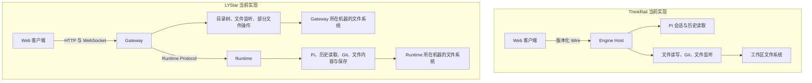
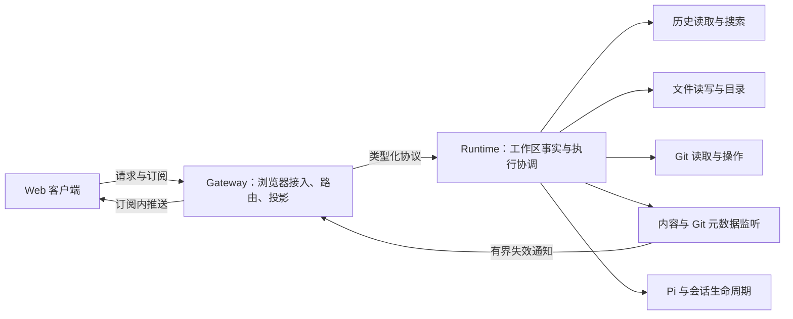

# ThinkRail 与 LYStar Code Web：历史消息、Git、文件树及 Runtime/Gateway 对比

调研日期：2026-10-18。

**结论：LYStar 已有可验证的工程基础，但工作区能力的归属、刷新边界和执行预算没有统一。应保留 Runtime/Gateway 分层，先补这些缺口。ThinkRail 最值得学习的是具体行为契约及其验证方式；现有证据不支持整体替换技术栈、历史读取后端或通信协议。**

本文保留调研时的基线；后续改造与实测另列在第 9.1、9.2 节。当前实现以源码为准。

## 1. 依据与结论范围

| 对象 | 本次检查的基线 | 说明 |
| --- | --- | --- |
| ThinkRail | `JetBrains/thinkrail`，`3bee4f16454515674c5548cb96ed46c57c2a4956`，提交日期 2026-10-16 | 从官方仓库浅克隆。README 标为 JetBrains incubator 项目，明确使用进程内 Pi SDK。 |
| LYStar Code | 本地 `fa3ac6ab4aa1bb4cef92f598894534fe3b5ce47f` | 工作区原有 `packages/web/src/components/workbench/dialogs.tsx` 修改未纳入本次结论。 |
| 调查方法 | 官方源码、模块规范、协议与调用链对照，运行 LYStar 相关现有测试 | 未启动 ThinkRail、未安装其依赖；未做同机同负载的两端性能对比。 |

下文区分三种依据：

- **源码事实**：当前代码直接实现的行为。
- **工程推断**：由代码路径推导出的影响；没有现场复现的，明确标出。
- **建议**：针对 LYStar 的改进方向，尚未实施。

没有用文件数量、代码行数、公司背景或界面观感给工程成熟度打分。CodeGraph 的本地图谱存在待处理变更，因此本次链路判断以源码为准，没有修改索引。

来源：[T1]、[T2]、[L1]。

## 2. 最直观的差异：谁拥有工作区事实

下面只展示本次关注的文件、Git、会话读取路径，不代表完整系统拓扑。

**ThinkRail 把客户端需要的工作区事实收在同一个 Host；LYStar 把同一工作区的文件能力分在 Gateway 和 Runtime。**

这不是说多一个进程就错。LYStar 的持久 Runtime、浏览器接入层和 TUI 协作有独立职责，足以解释这层分离。真正需要收口的是：目录、文件内容、保存、重命名、删除、Git 和变更通知应由同一个工作区拥有者提供。Gateway 可以继续负责浏览器接入、鉴权、路由和协议投影。

当前 Runtime 的连接信息明确返回 `remoteProfilesSupported: false`。因此，分机文件系统不一致是**架构限制与未来阻塞点**，不能写成当前已支持远程模式的线上故障。同机模式下，这种分散仍增加了路径处理、错误语义和生命周期维护的位置。

源码：[T2]；[L2] `projectTree()`、`ensureProjectWatcher()`、文件路由；[L3] Git 与文件方法；[L4] `get_connection_status`。

## 3. 能力对比：不能简单判断谁“全面更工程化”

| 维度 | ThinkRail 已实现 | LYStar 已实现 | 本次判断 |
| --- | --- | --- | --- |
| 历史正文读取 | `session.getMessages` 返回会话消息；磁盘会话不存在于管理器时先 attach | 独立 Go 读取进程、SQLite 元数据与检查点、正文分页、内容引用、传输预算 | LYStar 这里已有更明确的大历史读取边界，不宜换成全量消息返回。 |
| 历史搜索 | 跨磁盘会话的懒加载内存索引；支持提示词召回与消息定位 | 当前核对的 `search_transcript` 是单会话搜索，有有界缓存及磁盘扫描模式 | 两者产品范围不同，不能把两种搜索的速度直接比较。 |
| 消息同步 | 连接代次、事件修订号、快照缓冲、压缩后重读、过期响应拒绝 | transcript generation/revision、leaf、过期响应判断、WS 序号、断档后恢复 | 两者都有一致性机制。LYStar 不是没有版本和恢复设计。 |
| 重试与执行记录 | 请求 ID、载荷指纹、ACK、断线恢复缓存；缓存位于 Host 内存 | journaled 操作有持久日志、载荷冲突检查、重启后中断标记 | LYStar 的持久操作记录应保留；两者都不能据此宣称外部副作用天然 exactly-once。 |
| 文件树 | 按目录请求、目录链折叠、工作区刷新 tick、请求代次判断 | 按目录请求、目录缓存、路径相关刷新、部分请求合并与代次判断 | LYStar 也有增量读取与缓存。主要差距在监听和能力归属。 |
| 文件变更通知 | 无效化通知、安静期与最大等待时间、路径上限、启动补偿、根 inode 检查、外部 gitdir 监听 | 目录级原生监听、子目录 inode 重绑、初始化补偿、路径上限、150ms 安静期 | ThinkRail 对持续写入和 linked worktree 的处理更完整。 |
| Git | 统一 Diff 范围、运行窗口快照、有时限的异步读取、独立内容分类 | 异步 Git、多仓库发现、拓扑缓存、状态/统计分离、幂等写入、写入中止信号 | LYStar 已有重要优化；执行时限和工作区语义可借鉴 ThinkRail。 |
| 流式展示 | Pi 事件批处理、虚拟列表、分块 Markdown、渲染性能场景 | 虚拟列表、Runtime/Gateway 进度合并、WS 背压、内容分页 | 不能只凭观感把卡顿全部归因 Runtime/Gateway。 |
| 维护约束 | 模块 SPEC、可执行依赖边界检查、打包 seam 检查、性能回放场景 | Web 职责文档、协议 Schema、相关测试、请求/排队/CPU 诊断能力 | 值得借鉴的是让边界及性能预算可重复验证，而非增加另一套文档或诊断平台。 |

来源：[T3]—[T15]、[L2]—[L14]。表内是源码能力对照，不是性能排名。

## 4. 历史消息：应该吸取什么，保留什么

### 4.1 ThinkRail 把“历史”分成了三个问题

**历史搜索。** `HistoryIndex` 自行枚举 Pi JSONL 文件，避免为了搜索调用会全量解析会话的 `SessionManager.listAll()`。它用文件的 `mtime + size` 判断是否需要重读，约 2 秒后才再次触发校验；热查询期间后台刷新，冷查询等待约 150ms 后可以返回部分结果及 `indexing: true`。

150ms 是调度预算，**不是严格响应上限**。文件读取之后的 `extractSession()` 仍在同一事件循环同步解析；单个巨大文件的解析不会被定时器抢占。索引保存用户与助手的完整文本，搜索逐条匹配，因此也没有形成一个天然有界的大语料搜索系统。[T3]

**搜索结果与正文对齐。** `extractSession()` 使用 Pi 的解析、迁移和 `buildSessionContext()`，沿当前分支与压缩语义得到消息；搜索与正文共享消息角色判断，并跳过内部控制文本及已被重试替代的失败尝试。搜索命中带 `messageIndex` 和文本锚点，客户端可校验目标是否仍然存在。[T4]

**断线和压缩后的正文恢复。** 客户端用连接代次和事件修订号判断一次重读是否仍有效。读取期间如果有新事件到达，旧结果不能直接替换当前内容；仍在流式运行时，可以等待空闲后再同步。批量 Pi 事件在处理其他响应前先 flush，避免为了批处理打乱顺序。[T5]、[T6]

### 4.2 LYStar 已有的能力，比“重新做历史系统”更有价值

LYStar 的 `SessionReadIndex` 把读取工作交给独立 Go 子进程。SQLite 保存文件身份、读取偏移、元数据和子会话索引，历史引擎负责分页读取与内容引用；它并不是把全部正文直接存成 SQLite 全文索引。`read_transcript` 不要求先为磁盘历史创建 AgentSession。[L5]、[L6]

前端已有 generation/revision、leaf、过期响应检查，Gateway 也有有界的 WS 事件回放与 gap 判断。这些都是真实工程能力。[L7]、[L8]

本次运行的历史测试还覆盖了 1 万轮工具调用记录的完整分页、不重复搜索，以及该测试夹具下热搜索 p95 ≤ 50ms 的断言。**这仅证明本机夹具满足断言，不代表线上任意大历史都能达到 50ms。**[L9]

### 4.3 建议

保留 Go/SQLite 读取方案、正文分页、内容引用和版本游标。重点检查并统一：

1. 历史显示、搜索和实时消息投影对“当前分支、压缩、内部消息、重试”的语义是否一致。
2. 每种 revision/generation 各自表示什么，以及快照在什么条件下允许覆盖当前状态。
3. 重连恢复能否持续保持“读取权威状态 → 校验版本 → 接上增量”的规则。

这是需要进一步核对的**语义契约**，本次没有证明 LYStar 已存在某个确定的压缩搜索错误。也不建议照搬 ThinkRail 的全量消息返回、进程内全文内存索引或重开历史时 attach AgentSession 的方式。

## 5. Git：ThinkRail 更值得借鉴的是范围和执行边界

### 5.1 一个服务端定义 Diff 范围

`resolveDiffRange()` 集中定义：

| 范围 | 比较内容 |
| --- | --- |
| branch | 分支与基线的 merge-base 到当前工作区 |
| uncommitted | HEAD 到当前工作区 |
| pinned | 指定提交到当前工作区 |
| commit | 单个提交与父提交；处理根提交 |
| turn | 两个运行窗口快照的 tree 对象 |

状态列表、文件两侧内容和后续操作使用同一范围定义，减少“列表展示一种比较、文件打开又用另一种基线”的风险。[T7]

LYStar 当前核对的接口主要表达 staged/unstaged、提交和仓库路径。如果后续要做“这次任务改了什么”，建议由 Runtime 定义显式范围及已解析的基线版本，再让状态、统计和内容共用；不要由不同面板自行组合 Git 参数。这是产品扩展建议，不是当前所有 Diff 都错误的结论。[L3]

### 5.2 运行窗口快照，让改动可以回看

ThinkRail 在 `agent_start` 与 `agent_settled` 附近记录工作区 tree。它复制 Git index，用 `GIT_INDEX_FILE` 指向临时 index，再 `add` 与 `write-tree`，因此不必移动真实 HEAD 或污染用户暂存区。记录保留最近 30 个运行窗口。[T8]

这能回答“这轮运行前后工作区变了什么”。但**不等于证明所有变化都由这个 Agent 引起**：同一工作区内的其他会话和人工修改也可能落在窗口里。LYStar 若采用，应以运行窗口变更命名；需要严格隔离时，才使用已确认的独立 worktree。

### 5.3 Git 子进程必须有自己的执行时限

ThinkRail 的异步 Git runner 默认设 55 秒时限，区分启动失败、超时和 Git 正常非零退出，并保留实际 stderr；同步 runner 仍存在，所以不能说它已完全消除事件循环阻塞。[T9]

LYStar 的 `git()` 是异步 `execFile`，有输出上限，但没有执行时限；`gitWrite()` 接受中止信号，也没有独立时限。Runtime 客户端默认 30 秒请求超时，对于隔离读取，超时后会忽略迟到结果并保留连接。[L3]、[L10]

**工程推断：页面不再等待，不代表 Git 子进程已经退出。** 卡住的读取仍可能占用当前读取批次与并发名额；普通后续操作还可能等待批次结束。这是当前代码路径的缺口，本次没有用挂死 Git 现场复现。[L11]

建议让子进程时限早于外层请求时限，并确保超时结束子进程及释放名额。不要直接把 ThinkRail 的 55 秒复制过来，因为 LYStar 的外层默认预算是 30 秒。慢网络写入若需要更长时间，应由操作回执和状态查询承载，而不是只延长同步等待。

## 6. 文件树与刷新：最明确、最有收益的借鉴点

### 6.1 两者都采用“通知失效，再读取事实”

ThinkRail 的 `workspace.fsChanged` 表示相关数据可能已变化，客户端重新调用文件、Git 等读取接口。LYStar 的 `project_files_changed` 也会触发已加载目录、打开文件和 Git 面板相关读取，因此**无效化设计本身 LYStar 已经有了**。[T10]、[L12]

ThinkRail 的文件树按目录读取，并压缩单子目录链。需要注意，目录行的 `useWorkspaceRead` 在挂载时就会读取以解析目录链，不能把它描述成“所有折叠目录都绝不预取”。它的统一工作区 tick 也可能触发多个已挂载读取，不等于具有精确到路径的最优调度。[T11]

### 6.2 持续写入需要最大等待时间

ThinkRail 的文件事件合并同时设定：300ms 安静期、1000ms 最大等待、最多 100 条路径；超限后发送通配失效。最大等待定时器不会随着每次事件重置。[T10]

LYStar Gateway 设 150ms 安静期，每次正常事件都会重置定时器，没有最大等待定时器。持续修改少量相同路径时，通知可能一直等到写入停止。路径集合超过 256 条后会进入通配状态，后续提前返回，因此**不是所有事件风暴都会无限推迟**；缺口主要在持续但路径较少的写入。[L2]

这是源码可推导的刷新饥饿条件，尚未现场复现。建议沿用当前合并器，增加最大等待时间；数值根据本地负载确定。

### 6.3 linked worktree 的 Git 元数据可能在根目录外

ThinkRail 识别 `.git` 文件中的 `gitdir:` 指针，在实际 Git 元数据目录位于工作区外时，另建一个非递归监听器。因此 linked worktree 里只移动 HEAD、index 的操作也能触发 Git 相关重读。[T10]

LYStar 的 `ProjectFileWatcher` 递归发现物理子目录；`.git` 如果是文件，不会沿其指针找到外部 gitdir。**工程推断：外部终端在 linked worktree 中提交、且工作区内容未改变时，Git 面板可能缺少及时刷新的信号。** 普通仓库内的 `.git` 目录会被当前监听器遍历，不能把这写成所有仓库都收不到 Git 更新。[L13]

建议单独处理 Git 元数据失效。文件树内容和 HEAD/index 状态虽然有关联，但不能只依赖工作区内容写入来刷新 Git。

### 6.4 监听范围、生命周期要明确

ThinkRail 在通知层过滤 `.git` 内容噪声、`node_modules` 和 `.DS_Store`，对 Git 元数据另走通知；建立监听后补一次通配失效，每次 ensure 时检查工作区根 inode，处理根目录被删除后重建。仅用于预热的监听池有上限。[T10]

LYStar 已经处理子目录删除重建、监听初始化补偿和路径上限，但当前递归扫描只跳过 `.git/objects`，仍会进入 `node_modules` 等目录。监听数量和初始化扫描工作随实际目录数增加；本次没有测量实际 CPU 或句柄消耗。[L13]

建议保留现有跨平台监听方案，补项目可确定的噪声目录策略、根目录身份检查和 Git 元数据覆盖。过滤监听噪声不必改变文件树可见内容。也不能把 ThinkRail “一次递归 watch API 调用”理解成底层只有一个系统句柄。

## 7. 其他值得吸取的优化，以及适用边界

| ThinkRail 的做法 | 解决的问题 | 对 LYStar 的建议 |
| --- | --- | --- |
| Pi 事件约 32ms 批处理，最多 128 条；处理其他消息前先 flush | 降低前端更新频率，同时保持跨消息顺序 | 核对已有进度合并和前端更新成本。只合并可替换状态；不可丢掉正文增量或完成边界。[T6] |
| 分块并 memo 的 Markdown | 避免每个 token 都重新处理已完成块 | 若浏览器诊断确认 Markdown 是瓶颈，可局部借鉴。不能据此要求改 Runtime。[T12] |
| 统一字节分类和内容身份 | 编辑器、文件预览、Diff、回退看到同一资源含义 | LYStar 已有保存时的 expectedHash 与内容版本。重点复用这些机制，不必为了对齐再加一套哈希。[T13]、[L2] |
| Git 回退依据当前两侧版本校验，回执可撤销 | 防止基于旧 Diff 覆盖新改动 | 若扩展局部回退，可借鉴双侧版本与显式范围。ThinkRail 的撤销回执在内存中，重启后失效，不能称为持久恢复。[T14] |
| 可执行模块依赖规则 | 防止 UI、Host、Pi 扩展的依赖边界逐渐失效 | 对已有明确边界做机械检查，比再写一套原则更有价值。[T15] |
| 固定流事件回放、长 Markdown、编辑器及布局隔离性能场景 | 将“卡不卡”变成可重复观察的工作负载 | 先复用 LYStar 现有请求日志、排队时间、CPU 采样和浏览器诊断。新增性能场景属于后续实施范围，本次未创建。[T16]、[L14] |

ThinkRail 的持久化也有边界：项目与工作区等元数据仍采用同步 JSON 文件读写，部分会话元数据使用临时文件加 rename；文件读取仍有 `readFileSync`。因此它是有明确取舍的单 Host 应用，不是一个已消除所有阻塞和崩溃窗口的分布式模板。[T17]、[T13]

## 8. LYStar 的改进顺序

以下是建议顺序，不是已执行的改造计划。每步都应有能观察用户结果的完成依据。

| 顺序 | 改什么 | 为什么优先 | 完成后应能证明什么 |
| --- | --- | --- | --- |
| 1 | 补文件监听最大等待时间及 linked worktree 元数据失效 | 当前源码有明确触发条件，直接影响“界面是否跟得上真实工作区” | 持续写入时仍按预算更新；外部终端提交后，Git 状态和打开的相关 Diff 能刷新。 |
| 2 | 给 Git 子进程建立执行时限，统一与外层等待预算的关系 | 避免一次卡住读取持续占用批次和并发名额 | 请求结束时相关子进程和资源已释放；同连接后续操作可继续。 |
| 3 | 将工作区文件能力归到 Runtime，Gateway 保留接入与投影 | 收口目录、内容、保存、重命名、删除、归档、下载、监听的事实来源 | 同一工作区所有文件入口读取同一根目录，行为与错误语义一致。分机验证仅在远程能力进入实施范围后进行。 |
| 4 | 整理历史读取、搜索、实时流的语义与版本契约 | 已有底层机制值得保留，下一步是减少语义漂移 | 分支切换、压缩、重试、重连交错时，显示、搜索与定位能解释并保持一致。 |
| 5 | 根据现有诊断建立少量固定性能场景，再决定缓存或合并 | 当前没有两端同负载数据，不能先认定根因 | 能区分等待发生在排队、Git、历史投影、传输还是浏览器渲染；改前改后同负载可比较。 |

建议收口后的目标如下。它保留 Runtime/Gateway 架构，只调整工作区事实的归属。

不建议为了“看起来正规”新增微服务、消息队列或另一套数据库；也不建议先把大文件机械拆开再宣称工程化完成。职责移动应围绕上述用户行为和真实生命周期逐项完成。

## 9. 本次实际验证

本次运行了以下已有定向测试：

| 执行位置与命令 | 结果 | 证明范围 |
| --- | --- | --- |
| `packages/web-runtime`：`node ../../node_modules/vitest/dist/cli.js --run test/transcript-reader.test.ts test/operation-journal.test.ts test/runtime-read-concurrency.test.ts` | 3 个文件、28 项通过 | 历史分页/游标/大行/搜索、操作幂等/持久记录/重启中断、并发配置计算。并发配置测试不证明真实队列吞吐。 |
| `packages/web-gateway`：`node --import tsx --test test/project-file-route.test.ts test/git-routes.test.ts test/runtime-read-timeout.test.ts` | 3 项通过 | 文件路由版本与保存、Git 路由映射、只读请求超时隔离。路由夹具不证明真实 Git 子进程行为。 |

**仍未验证：** ThinkRail 实际启动与测试结果；两端同负载延迟、内存与 CPU；监听饥饿与 linked worktree 更新的现场复现；真实 Git 卡死后的资源释放；本地实际服务当前的慢请求来源。报告中的相关影响属于明确标注的源码推断。

已有诊断能力足以支持下一轮取证。需要定位实际卡顿时，应读取指定时间窗内的请求与 CPU 证据，而不是由这份静态对比替代现场诊断。

### 9.1 后续实施与实测（2026-10-18）

调研后的改造已将目录读取、文件修改、归档、上传下载和监听委派到 Runtime；Gateway 保留 HTTP、流式传输与错误投影。监听增加最大等待时间、根目录身份检查及外部 Git 元数据覆盖；历史搜索绑定当前叶节点与实际读取的文件修订。前端刷新将文件读取与 Git 读取分开合并，文件树复用现有虚拟列表，自动预览改为一次条件读取。

下列数据来自同机 Linux 回环地址上的独立临时源码实例。它们是单轮观测，不代表生产环境的延迟或吞吐保证。

| 场景 | 改前 | 改后 | 条件与验证 |
| --- | --- | --- | --- |
| 展开一万个文件 | 23,483ms；10,005 个树节点 | 879ms；19 个树节点 | 从目录请求发起计至树行显示；接口分别为 730ms、677ms。末项滚动、三级目录、一万项范围选择与右键菜单均已核对。 |
| 大目录浏览器堆采样 | 约 417MiB | 约 71MiB | 在树行显示时采样；未强制 GC，不作为稳定内存上限。 |
| 文件变化后更新预览 | 元数据与正文串行两次请求，338ms | 一次条件读取，211ms | 浏览器为每次文件请求注入 150ms 延迟。未变化时一次请求返回 304，适配器返回 `undefined`，现有正文保留。 |
| Git 状态读取延迟 2 秒时读取目录 | 三次目录读取为 16/1,057/2,116ms | 16/13/13ms | 只在临时 Runtime 的 Git 命令中注入延迟；沿用原有五秒 Git 兜底刷新。 |

实际 HTTP 验证确认：不存在路径返回 404；权限不足返回 403；ZIP 遇到权限失败时不发布部分压缩包；不存在的符号链接目标沿用跳过行为；保存冲突返回 409 并保留外部写入，按当前哈希保存成功。未注入真实磁盘 I/O 故障。

真实模型观测完成两轮各 55 秒的持续工具输出、160 行助手回复、一次手动压缩及压缩后的继续回复。历史保留各轮首尾标记和最后一行，浏览器显示压缩记录及最终回复。断开连接 700ms 后服务端明确返回 `gap: true`；发送器允许替换待发送的完整状态，序号跳变本身不能作为正文丢失的依据。首次压缩因会话小于默认保留量被拒绝；仅在临时实例把最近保留量设为 128 Token 后完成压缩。此项验证手动压缩恢复，不证明长会话自动压缩阈值。

完整 `npm run check` 通过。最后一轮 Web 定向测试 27 项通过，Gateway 文件路由 1 项通过，Runtime 定向测试 47 项中 46 项通过。剩余失败为既有 `projects only displayed custom message content`：`display:false` 消息当前实现为扩展输入卡片，测试仍要求隐藏。该源码和测试本轮均未改动，保留现有展示行为，未把这项冲突计为通过。

本次原始观测保存在本机 `/tmp/lystar-refresh-results-20261018.json`、`/tmp/lystar-files-results-20261018.json`、`/tmp/lystar-file-contract-results-20261018.json`、`/tmp/lystar-stream-results-20261018.json` 与 `/tmp/lystar-stream-summary-20261018.json`；临时观测文件不作为仓库测试入口。

### 9.2 后续验收与内部请求优化（2026-10-18）

扩展消息沿用现有展示契约：`display:false` 仅投影为扩展输入卡片；`display:true` 使用自定义消息正文投影。既有投影用例已同步到该契约，25 项通过。

大目录测量拆分了枚举、列表整理、校验、CBOR 编解码和 HTTP。工作区命令结果现按命令缓存同一 Schema 的编译校验器。预览增加单次 Runtime 命令，把元数据、条件版本、正文和读取后核验放在同一请求中；Runtime Protocol 升至 14。下表每项运行六轮，首轮预热，取后五轮中位数；使用同机源码实例，不注入网络延迟。

| 场景 | 优化前 | 优化后 | 依据与范围 |
| --- | --- | --- | --- |
| 10,001 项目录结果校验 | 132.5ms | 0.9ms | 同一目录结果与同一 Schema。 |
| 10,001 项目录 HTTP | 542.7ms | 244.6ms | 一万个普通文件和一个嵌套目录；浏览器树行仍为 19 个。 |
| 小文本预览 | 11.2ms；3 次内部请求 | 8.3ms；1 次内部请求 | 1,310 字节文本。 |
| 超过 2MiB 的文本预览 | 107.2ms；4 次内部请求 | 100.0ms；1 次内部请求 | 仍只返回前 2MiB，并标记截断。 |

文件 HTTP 观测确认未变化返回 304，变化后返回新版本正文；读取中发生变化及保存哈希失配均返回 409。空文件、文本、图片和二进制预览通过；8MiB 二进制完整返回，超过 8MiB 时保留截断标记并省略正文。资源不存在原先返回 500，现已补齐 `resource_not_found` 的 404 映射；路径解析保留权限错误，实际读取权限不足返回 403。独立进程持续替换文件时，八次读取中七次返回读取冲突 409，一次读取到稳定版本并返回 200。

真实模型观测在临时实例将声明窗口设为 24,576 Token、预留量设为 16,384 Token，以触发实际自动压缩。76 秒内记录到三组原因均为 `threshold` 的开始与完成事件。第一次压缩运行时关闭界面 WebSocket；界面随后携带 `lastSeq:111` 重新订阅，服务端确认 `seq:115`、`gap:false`，压缩完成后继续回复成功。另一个会话的请求与主会话工具输出重叠，均完成。

随后增加一次 35 秒工具输出，在运行中切至其他会话：连续八次界面采样均显示目标会话及其回复，没有主会话标记。切回主会话后最终回复恢复，最后一轮完成标记恰好一次；69 个投影视图按 `entryId + viewIndex` 计无重复，最终会话为空闲。单条记录可以有多个投影视图，不能只按 `entryId` 判重复。浏览器堆只记录为观测值；这些工作负载不证明长期无泄漏。

最终完整 `npm run check` 通过。Web 定向测试 29 项、Runtime 投影与传输/读取并发定向测试 38 项，以及相关协议、Gateway 文件路由、超时隔离和协议升级用例通过。另行运行 `runtime-adapter.test.ts` 与 `transcript-file-context.test.ts`，35 项中 32 项通过、3 项失败：会话列表缓存独立性、首次回复自动标题、Room 后排队普通输入。这三项失败与本次路径解析改动无关，仍未通过。

原始数据保存在本机 `/tmp/lystar-followup-directory-{before,after}-20261018.json`、`/tmp/lystar-followup-preview-{before,after}-20261018.json`、`/tmp/lystar-followup-file-contract-20261018.json`、`/tmp/lystar-followup-binary-boundary-20261018.json`、`/tmp/lystar-followup-recovery-results-20261018.json`、`/tmp/lystar-followup-switch-results-20261018.json`、`/tmp/lystar-followup-browser-evidence-20261018.json`。汇总为 `/tmp/lystar-followup-summary-20261018.json`，观测脚本未加入仓库测试入口。

## 10. 源码索引

ThinkRail 链接固定到本次提交，避免 main 后续变化影响结论。LYStar 链接指向当前工作区对应源码。

### ThinkRail 官方来源

- [T1：README，项目身份与 Pi 使用方式](https://github.com/JetBrains/thinkrail/blob/3bee4f16454515674c5548cb96ed46c57c2a4956/README.md)
- [T2：架构与 Host 组织](https://github.com/JetBrains/thinkrail/blob/3bee4f16454515674c5548cb96ed46c57c2a4956/architecture.md)
- [T3：懒加载历史搜索索引](https://github.com/JetBrains/thinkrail/blob/3bee4f16454515674c5548cb96ed46c57c2a4956/packages/server/src/history/historyIndex.ts)
- [T4：Pi 消息树及搜索投影](https://github.com/JetBrains/thinkrail/blob/3bee4f16454515674c5548cb96ed46c57c2a4956/packages/server/src/history/extract.ts)
- [T5：正文重连与压缩同步](https://github.com/JetBrains/thinkrail/blob/3bee4f16454515674c5548cb96ed46c57c2a4956/apps/web/src/chat/useTranscriptSync.ts)、[快照与推送衔接](https://github.com/JetBrains/thinkrail/blob/3bee4f16454515674c5548cb96ed46c57c2a4956/apps/web/src/transport/wireTransport.ts)、[历史重开与消息返回](https://github.com/JetBrains/thinkrail/blob/3bee4f16454515674c5548cb96ed46c57c2a4956/packages/server/src/agent/agentSessionManager.ts#L1816)
- [T6：Pi 事件批处理](https://github.com/JetBrains/thinkrail/blob/3bee4f16454515674c5548cb96ed46c57c2a4956/apps/web/src/transport/piEventBatcher.ts)
- [T7：统一 Diff 范围](https://github.com/JetBrains/thinkrail/blob/3bee4f16454515674c5548cb96ed46c57c2a4956/packages/server/src/git/diffScope.ts)
- [T8：临时 index 快照](https://github.com/JetBrains/thinkrail/blob/3bee4f16454515674c5548cb96ed46c57c2a4956/packages/server/src/git/snapshot.ts)、[运行窗口记录](https://github.com/JetBrains/thinkrail/blob/3bee4f16454515674c5548cb96ed46c57c2a4956/packages/server/src/turns/turns.ts)
- [T9：Git 执行器](https://github.com/JetBrains/thinkrail/blob/3bee4f16454515674c5548cb96ed46c57c2a4956/packages/server/src/git/gitExec.ts)
- [T10：文件与 Git 元数据监听](https://github.com/JetBrains/thinkrail/blob/3bee4f16454515674c5548cb96ed46c57c2a4956/packages/server/src/watch/watch.ts)、[带最大等待的事件合并](https://github.com/JetBrains/thinkrail/blob/3bee4f16454515674c5548cb96ed46c57c2a4956/packages/server/src/watch/coalesce.ts)
- [T11：文件树](https://github.com/JetBrains/thinkrail/blob/3bee4f16454515674c5548cb96ed46c57c2a4956/apps/web/src/panels/FileTree.tsx)、[工作区读取生命周期](https://github.com/JetBrains/thinkrail/blob/3bee4f16454515674c5548cb96ed46c57c2a4956/apps/web/src/panels/useWorkspaceRead.ts)
- [T12：Markdown 分块渲染](https://github.com/JetBrains/thinkrail/blob/3bee4f16454515674c5548cb96ed46c57c2a4956/apps/web/src/chat/Markdown.tsx)
- [T13：文件读取与资源分类](https://github.com/JetBrains/thinkrail/blob/3bee4f16454515674c5548cb96ed46c57c2a4956/packages/server/src/fs/files.ts)、[资源分类契约](https://github.com/JetBrains/thinkrail/blob/3bee4f16454515674c5548cb96ed46c57c2a4956/packages/server/src/fs/SPEC.md)
- [T14：Diff 回退与撤销契约](https://github.com/JetBrains/thinkrail/blob/3bee4f16454515674c5548cb96ed46c57c2a4956/packages/server/src/changes/SPEC.md)
- [T15：模块边界检查](https://github.com/JetBrains/thinkrail/blob/3bee4f16454515674c5548cb96ed46c57c2a4956/scripts/check-module-boundaries.ts)
- [T16：渲染性能场景](https://github.com/JetBrains/thinkrail/blob/3bee4f16454515674c5548cb96ed46c57c2a4956/e2e/perf/render.perf.ts)
- [T17：JSON 元数据持久化](https://github.com/JetBrains/thinkrail/blob/3bee4f16454515674c5548cb96ed46c57c2a4956/packages/server/src/persistence/persistence.ts)、[内存请求恢复缓存](https://github.com/JetBrains/thinkrail/blob/3bee4f16454515674c5548cb96ed46c57c2a4956/packages/server/src/host/requestReplayCache.ts)

### LYStar 本地来源

- [L1：Web 架构总览](../development/web-overview.md)
- [L2：Gateway 路由与监听协调](../../packages/web-gateway/src/server.ts)
- [L3：Runtime 适配器，Git 与资源读写](../../packages/web-runtime/src/runtime-adapter.ts)
- [L4：Runtime 服务与命令分发](../../packages/web-runtime/src/service.ts)
- [L5：独立历史读取进程客户端](../../packages/web-runtime/src/session-read-index.ts)
- [L6：Go/SQLite 元数据与读取检查点](../../packages/web-runtime/native/session-index/main.go)、[分页与搜索读取器](../../packages/web-runtime/src/transcript-reader.ts)
- [L7：前端会话与历史版本判断](../../packages/web/src/state/session-sync.ts)
- [L8：有界 WebSocket 写入](../../packages/web-gateway/src/websocket-writer.ts)
- [L9：历史读取现有测试](../../packages/web-runtime/test/transcript-reader.test.ts)
- [L10：Runtime 客户端超时](../../packages/web-protocol/src/client.ts)、[Gateway 只读超时隔离](../../packages/web-gateway/src/runtime-client.ts)
- [L11：Runtime 输入调度与批次](../../packages/web-runtime/src/stream-transport.ts)
- [L12：前端文件刷新](../../packages/web/src/state/workbench-file-actions.ts)、[Git 读取与操作](../../packages/web/src/state/workbench-git-actions.ts)
- [L13：目录级文件监听器（后续已迁至 Runtime）](../../packages/web-runtime/src/project-file-watcher.ts)
- [L14：现有诊断入口](../../scripts/diagnose-web-performance.mjs)、[SQLite 诊断日志](../../packages/web-runtime/src/service-event-log.ts)
- [L15：持久操作日志](../../packages/web-runtime/src/operation-journal.ts)
- [L16：前端虚拟会话列表](../../packages/web/src/components/workbench/conversation-list.tsx)、[进度合并](../../packages/web-gateway/src/progress-coalescing.ts)
