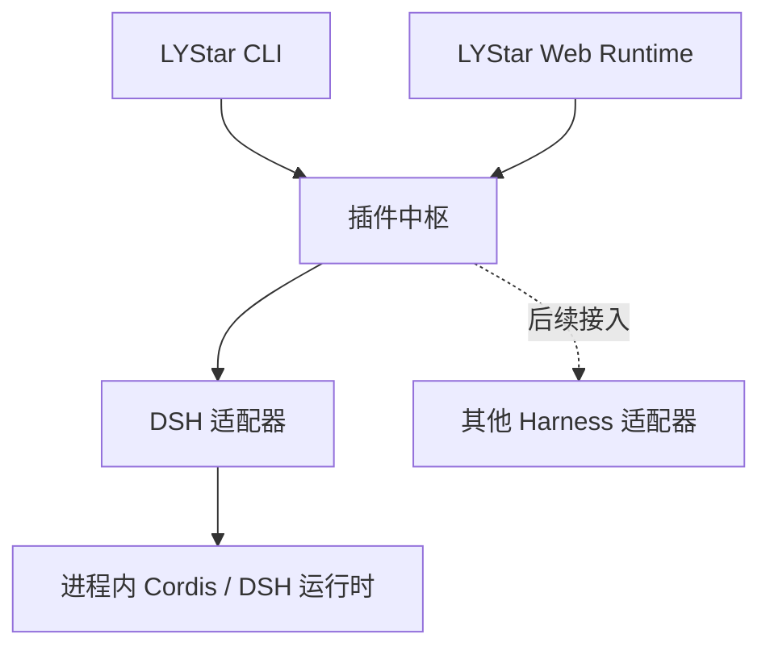

# DeepSeek Harness 适配器

`@lystar/deepseek-harness` 在 LYStar 进程内运行原版 Cordis/DSH 服务、插件和 Agent。当前固定版本为 `0.2.1-rc.2`，源码依据为 commit `687f282e8625c6b8d11ff58211a90524be2e4317`。

## 插件中枢

CLI 和 Web Runtime 共用 `/plugins` 入口。中枢负责来源注册、状态汇总和操作分发；DSH 适配器负责自己的包格式、配置、服务、资源、工具和会话生命周期。



新增来源实现 `PluginAdapter`，再加入 `createPluginHubExtension()` 的适配器数组。当前已实现 DSH；其他 Harness 根据各自协议和运行机制接入。

## 使用原版 Profile

在 LYStar 会话中执行：

```text
/plugins
/plugins dsh profile headless
/plugins dsh list
/plugins dsh run 阅读当前目录并说明主要文件
/plugins dsh cache
```

`headless` 加载原版 Base 与 Headless Bundle，主循环由 LYStar 调用。使用原版 Web 界面时执行：

```text
/plugins dsh profile web
/plugins dsh web
```

`/dsh <操作>` 与 `/plugins dsh <操作>` 共用同一处理器。`list` 展示条目状态、缺失服务和加载错误。原版 Web Profile 的部分工具由 Agent Preset 在会话作用域挂载，根 Loader 中的同名条目可以处于 disabled 状态。

安装使用 LYStar 的 `npmCommand` 设置。Profile 位于 `getAgentDir()/deepseek-harness/profiles/<名称>`，通过固定版本的 pnpm 安装原版 Bundle，并使用 hoisted 目录布局和 peer 依赖安装，以满足原版 YAML 对资源包的解析。初次安装跳过生命周期脚本；后续 Bundle 管理沿用原版管理器。

Profile 中的 Bundle 安装、更新和启停由原版 `PluginManager` 处理。安装目标使用明确版本，例如：

```text
/plugins dsh install @deepseek-ai/dsh-subagent-claude-code@0.2.1-rc.2
/plugins dsh disable @deepseek-ai/dsh-subagent-claude-code
/plugins dsh update @deepseek-ai/dsh-subagent-claude-code@0.2.1-rc.2
/plugins dsh reload
```

更新沿用原版界面的移除、安装顺序，并保留原来的启停选择。普通插件条目的启停使用其 entry id；原版管理器根据目标区分 Bundle 与条目。

## 按包加载插件

逐个选择 Cordis 包时，在 `deepseek-harness/plugins.json` 中使用 `plugins` 配置：

```json
{
  "plugins": [
    { "name": "@deepseek-ai/dsh-tool-fs", "config": { "readLimit": 500 } },
    { "name": "@deepseek-ai/dsh-tool-call-timeout-policy", "disabled": false }
  ]
}
```

该配置通过以下命令管理：

```text
/plugins dsh install @deepseek-ai/dsh-tool-fs@0.2.1-rc.2
/plugins dsh disable @deepseek-ai/dsh-tool-fs
/plugins dsh enable @deepseek-ai/dsh-tool-fs
/plugins dsh reload
```

包安装也接受本地目录，使用配置的 `npmCommand`，保存精确版本并跳过生命周期脚本。运行时沿用原版 `engines.dsh` 判断、Cordis Loader、Group、Include 和 `dsh.bundle.patch` 组合逻辑。包内相对路径以所属文件为基准，`deepseek-harness/cordis.patch.yml` 最后应用。

## 工具、资源与会话

插件工具以 `dsh__<原工具名>` 注册为延迟工具，存在工具时启用 `tool_search`。已启用 Codemode 的会话可以直接调用：

```js
text(await tools.dsh__read({ file_path: "README.md" }));
```

原版技能注册表中的本地 `SKILL.md` 和包内 `skills/` 接入 Pi 技能发现。图片和文件结果通过原版 attachments 服务读取；工具附加上下文保留来源信息。

每个 LYStar 会话拥有自己的 Context、Agent、工具和提示词服务。原版 Profile 使用 DSH V4 事件格式恢复 Pi 历史，映射工具名和元数据，并记录分支与原版会话的关联。SDK 仅提供历史消息而未提供 `systemPrompt` 时，导入空 system 首节点，后续步骤由原版 DSH 提示词服务更新。`run` 驱动原版主循环，模型请求通过 LYStar 模型目录与流接口执行。DeepSeek 原生模型适配保留原版 Messages 协议路径，并把 LYStar API Key 写入原版要求的 `x-api-key` 请求头。

## SDK 接入

把中枢工厂加入 `DefaultResourceLoader.extensionFactories`：

```ts
import {
  createCodemodeExtension,
  createPluginHubExtension,
  createToolSearchExtension,
  deepSeekPluginAdapter,
} from "@earendil-works/pi-coding-agent";

const extensionFactories = [
  { name: "plugin-hub", factory: createPluginHubExtension([deepSeekPluginAdapter]) },
  { name: "tool-search", factory: createToolSearchExtension() },
  { name: "codemode", factory: createCodemodeExtension() },
];
```

通过 `session.bindExtensions()` 绑定宿主的 `commandContextActions`，包括 `waitForIdle` 和 `reload`，使管理操作立即刷新资源与工具。SDK 的插件目录由 `getAgentDir()` 决定，隔离目录通过 `PI_CODING_AGENT_DIR` 指定。`deepSeekHarnessExtension` 提供只注册 DSH 的独立工厂入口。

## 缓存对照

缓存模块为官方 DeepSeek 地址的 `deepseek-flash`、`deepseek-v4-pro` 补充 `supportsMidConvoSystemMessages`，保留显式设置。变化的提示词 section 通过已有 system message 更新机制追加，运行上下文只在变化时记录。宿主工具声明按名称稳定排序，避免插件异步加载顺序改变请求前缀。`/plugins dsh cache` 展示当前分支的缓存 token、SDK 输入费用估算和前缀变化，包括工具声明是否变化、首个变化消息的索引和角色。

[交错对照数据](validation/cache-comparison.json)记录了 4 组、24 次官方 API 请求。每组分别预热两条路径，再交错执行相同的上下文更新和重复请求；所有响应均为 `OK`，且没有调用工具。

| 请求阶段，每项 4 次 | 未缓存输入 token | 缓存读取 token | 命中率 | SDK 输入费用估算，美元 |
| --- | ---: | ---: | ---: | ---: |
| 原行为，上下文更新后首次请求 | 6,545 | 0 | 0% | 0.00098175 |
| 优化后，上下文更新后首次请求 | 877 | 5,760 | 86.79% | 0.00014883 |
| 原行为，相同请求重复 | 785 | 5,760 | 88.01% | 0.00013503 |
| 优化后，相同请求重复 | 877 | 5,760 | 86.79% | 0.00014883 |

本样本中，上下文更新后首次请求的 SDK 输入费用估算下降约 84.84%；重复请求时两条路径均有缓存，优化路径的费用估算略高。样本量与延迟波动不足以得出平均收益或延迟提升结论。服务端 `usage.cacheRead` 用于确认命中，费用按 SDK 中的模型价格计算。

[真实 API 文件任务](validation/cache-file-tasks.json)补充了 3 组交错对照、6 个任务、25 次请求。每个任务都实际调用原版 read/write 工具，读取账单、计算总额并写入 JSON，6 个结果均正确。读取完成后追加 workflow system section，观察后续请求的缓存变化。

| 更新后请求，分别来自 3 个任务 | 请求数 | 未缓存输入 token 合计 | 缓存读取 token 合计 | 命中率 | SDK 输入费用合计，美元 |
| --- | ---: | ---: | ---: | ---: | ---: |
| 原行为 | 7 | 4,464 | 13,056 | 74.52% | 0.000708768 |
| 兼容更新路径 | 6 | 1,293 | 13,440 | 91.22% | 0.000234270 |

该阶段的输入费用合计下降约 66.95%；包含预热和所有任务请求时下降约 26.81%。两组模型调用次数不同，不能据此推断每次请求或生产任务的平均收益。样本包含约 7000 字符固定参考资料；工具排序的独立收益尚未测量。

[场景补充记录](validation/cache-scenarios.json)增加一组顺序对照，两条路径均完成 read、Workflow 计算、edit、分支历史替换、会话恢复、原版压缩和压缩后的文件任务。10 项场景均通过，共执行 28 次真实 API 请求；含工具声明的请求保持一致的声明顺序。

| 路径 | 请求数 | 未缓存输入 token | 缓存读取 token | 命中率 | SDK 输入费用，美元 | 模型请求耗时合计，秒 |
| --- | ---: | ---: | ---: | ---: | ---: | ---: |
| 原行为 | 13 | 47,728 | 114,048 | 70.50% | 0.007501344 | 16.712 |
| 兼容更新路径 | 15 | 37,852 | 165,760 | 81.41% | 0.006175080 | 22.195 |

该组先执行原行为，再执行兼容更新路径。两条路径的模型轨迹、请求数和压缩内容不同，费用为 SDK 估算，不能据此推断生产平均收益或延迟改善。

## 兼容清单与验证

插件中枢与内嵌 DSH 已通过本次上线验收。五个平台的 Node 包与独立程序全部通过，正式版本尚未发布。

[公开包清单](validation/plugin-inventory.json)记录指定源码下的 343 个发布包，包括 20 个 Bundle、79 个含客户端资源的包，列出入口、资源声明、peer 依赖、服务注入声明位置和加载状态。[功能验收记录](validation/functional-acceptance.json)补充原版工具、子智能体、外部协议、真实搜索和浏览器交互的执行证据。Loader 数量取本机 Linux 清单，跨平台结论取 CI 原生执行。

| 验证对象 | 结果 |
| --- | --- |
| 中枢分发 | 正式测试 13 项通过：多来源分发、参数保留、校验、错误隔离、等待空闲和 reload 上下文 |
| 原版 Web Profile | 根 Loader 共 193 项，166 active、27 disabled，pending/failed 均为 0；Agent 作用域可见 31 个工具 |
| 原版 Headless Profile | 根 Loader 共 99 项，90 active、9 disabled，pending/failed 均为 0；可见 25 个工具 |
| 默认工具 | 31 个 Web 工具均有实际执行：文件与内容搜索、工作目录、Todo、目标、后台任务、调度、Workflow、图片和交付物等 |
| 文件与平台 Shell | read/write/edit、Linux/macOS Bash、Windows PowerShell 通过；本机 Node 取消样本为 125 毫秒 |
| 原版主循环 | CI 模拟模型流程通过；[原版 Messages 真实 API](validation/native-messages.json)完成两轮 write/read 文件任务，未调用 Pi 模型流桥接 |
| 原版 Bundle 管理 | 可选 Claude Code Bundle 安装、更新、移除及禁用状态保留通过；外部 Claude Code 执行未覆盖 |
| 原版 Skill | 四份原版 Skill 接入 Pi；原版工具的技能发现与加载通过 |
| 子智能体 | 创建、fork、注册表查询、消息续接和中断通过 |
| 外部协议 | MCP stdio、Streamable HTTP 和 LSP stdio 通过本地协议夹具验收；LSP 覆盖 hover、definition、references、implementation |
| Web 搜索与抓取 | 原版 web_search 已真实请求官方 DeepSeek API 并返回来源；认证、服务端工具声明、结构化结果和引用通过协议检查，web_fetch 实际抓取通过 |
| 历史与生命周期 | V4 历史导入、分支恢复、会话隔离、重启与释放通过；真实 API 完成会话恢复、原版压缩及压缩后的文件任务 |
| 浏览器交互 | 14 项通过，覆盖消息与工具结果、文件 diff/预览、设置保存、问答、计划审批、分支、刷新恢复、终端、只读拒写和图片上传；运行错误为空 |
| Node 打包 SDK | 中枢命令、Codemode 调用和绑定 reload 后启停通过；CLI 保留同步加载前启用 Node 编译缓存的启动方式 |
| Linux x64/ARM64、macOS x64/ARM64、Windows x64 | 每个平台的 Node 包与独立程序均通过原生安装、Headless/Web 工具、原版主循环、Web 页面和 Bundle 禁用后更新 |
| 现有相关测试 | 6 个文件、147 项通过 |
| 项目检查 | npm run check 通过 |

[五平台 CI 记录](validation/native-ci.json)对应提交 `89d901db112d549c21d33c73db2312c7be16b2c1`、运行 `39758746551`，十份运行报告的全部检查项通过。[运行与构建记录](validation/runtime-checks.json)保留早期产物的 SHA-256，并记录当前候选的上线结论。此流程只上传候选产物，创建版本 Tag 和发布 GitHub Release 的步骤均已跳过。

Node 包和 Bun 二进制共用 bundle-plugin.mjs 保留 DSH 包身份。Windows 独立程序包含 Koffi 原生模块，并分发原版 Job Runner 与沙箱 Runner 的 JS 入口。HMR 跳过 Bun 内嵌宿主入口，使用插件加载器的模块图处理插件代码和配置。

scripts/verify-dsh-release.mjs 已接入五平台 CI，包含隔离目录安装、Headless/Web 工具、原版主循环、Web 登录重定向和 Bundle 禁用后更新。CI 模型循环使用本地模拟服务；真实模型、搜索、缓存与浏览器结果分别归档。MCP/LSP 的协议夹具验证客户端行为，第三方生产服务可用性不在该结果范围内。可选外部 Claude Code 的实际执行按已确认范围不作为本次上线门槛。
